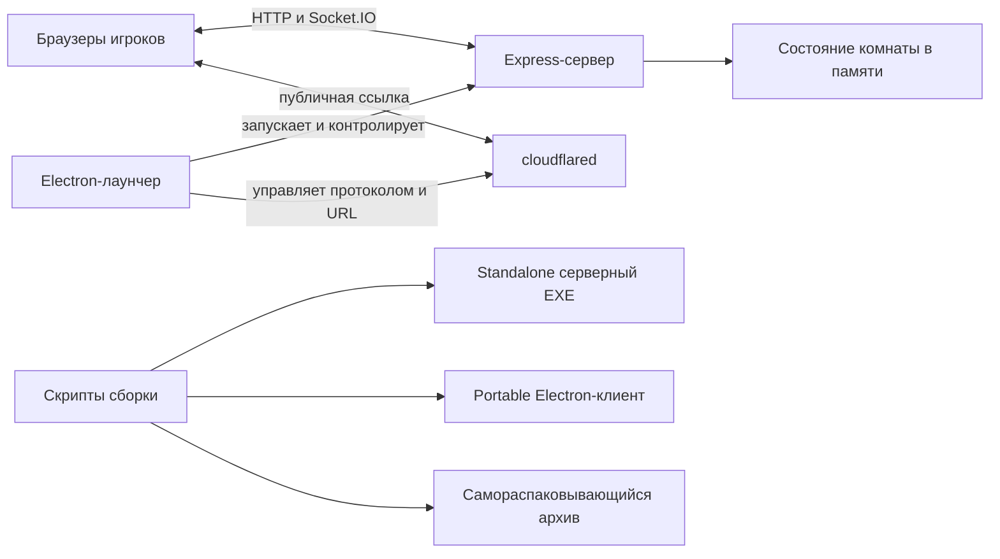

# Архитектура HomeAuction

## Назначение и общая схема

HomeAuction — веб-приложение для совместного распределения списка объектов между игроками. Сервер хранит состояние комнаты в памяти одного процесса и синхронизирует его с браузерами через Socket.IO. Клиент отвечает за отображение комнат, взаимодействие с пользователем, графическое колесо и локальные настройки. Дополнительно проект поставляется как настольный Electron-лаунчер, который поднимает локальный сервер, при необходимости создаёт публичный Cloudflare Tunnel и открывает игру в браузере.

## Структура репозитория

- `server.js` — точка входа веб-сервера и раздачи клиентских файлов.
- `src/` — конфигурация игры, серверное состояние, обработчики Socket.IO и расчёты колеса.
- `public/` — HTML, CSS, изображения и браузерный JavaScript.
- `desktop/` — Electron main process, preload, служебная логика туннеля и UI лаунчера.
- `scripts/` — сборка серверного EXE, портативного Electron-клиента и SFX-архива.
- `tests/` — проверки серверной логики, протокола туннеля, браузерных модулей и smoke-проверки проекта.
- `dist/` — локальные результаты сборки; это выходные артефакты, а не исходный код приложения.

## Сервер

### Запуск и HTTP

`server.js` создаёт Express-приложение, публикует каталог `public/` как статические файлы и подключает Socket.IO. Порт задаётся переменной окружения `PORT`; при обычном запуске используется порт 3000. HTTP обслуживает первоначальную загрузку интерфейса и статические ресурсы, а игровые события передаются по постоянному Socket.IO-соединению.

При запуске упакованного серверного EXE отдельно может подниматься Cloudflare Tunnel. Для режима, которым управляет Electron, передаётся `HOMEAUCTION_MANAGED=1`: это предотвращает запуск второго туннеля внутри сервера. Тогда жизненным циклом `cloudflared` и публичным адресом управляет desktop main process.

### Состояние и модели данных

`src/config.js` содержит значения настроек по умолчанию и единый каталог стартовых предустановок. Записи каталога задают ID, название, группу (`standard` или `experimental`), описание и настройки; из него формируется серверная таблица `ROOM_PRESETS`. В каталоге находятся базовый режим, дипломатия, хаос и экспериментальный режим «Всё или ничего» (минимальная положительная ставка — 50). Сервер проверяет ID и применяет настройки комнаты, поэтому клиентский каталог служит только для отображения. Идентификаторы комнат и участников создаются приложением, а не внешним хранилищем.

`src/state.js` представляет состояние комнаты в памяти процесса. Оно включает фазу игры (`POOL`, `REVEAL` или `FINISHED`), настройки, токен ведущего, участников, список объектов и данные колеса. Подключённый клиент получает подготовленный для него снимок состояния через `buildClientState`. В фазе распределения ставки других участников скрыты, чтобы игроки не видели чужие решения до раскрытия.

Постоянной базы данных нет. Перезапуск серверного процесса сбрасывает текущую комнату; локальное сохранение пользовательских параметров браузера не является резервной копией состояния комнаты.

### Socket.IO и правила игры

`src/socket-handlers.js` принимает клиентские события и проверяет право их выполнения. Первый обычный участник становится ведущим и получает host token; последующие действия ведущего авторизуются этим токеном. Спектатор не участвует в распределении. Изменения списка объектов и ставок ограничиваются допустимой фазой и ролями.

Основные операции комнаты:

1. Вход участника и выбор начальной конфигурации.
2. Создание, удаление и объединение объектов ведущим.
3. Распределение участниками очков между объектами.
4. Отметка готовности. Когда готовы все активные игроки, сервер переводит комнату к раскрытию. Если объектов для вращения нет, переход не выполняется и состояние готовности сбрасывается с сообщением об ошибке.
5. Вращение колеса, фиксация результата и обновление истории.
6. Сброс комнаты, отключение участника и отправка обновлённого снимка состояния.

Сервер является источником истины: клиент отправляет намерение, но окончательное изменение состояния и результат игры вычисляются серверной логикой.

### Выбор и фиксация результата колеса

`src/wheel-math.js` содержит детерминированные функции выбора. Предопределённый победитель выбирается с весом, соответствующим эффективному количеству очков объекта. Затем выбывающий объект выбирается среди оставшихся кандидатов с обратным весом; предопределённый победитель исключён из кандидатов, а правила защищают финальный оставшийся объект.

Сервер сначала рассылает план вращения, чтобы клиенты могли синхронно показать анимацию, а по таймеру фиксирует выбывание и историю. Идентификатор поколения вращения не позволяет устаревшему таймеру завершить уже отменённый или заменённый спин.

## Браузерный интерфейс

### Разметка и стили

`public/index.html` задаёт основную структуру страницы. `public/style.css` собирает тематические таблицы стилей из `public/css/`: переменные и темы, базовую раскладку, пул объектов, колесо и модальные окна. Такое разделение позволяет менять внешний вид отдельных областей, не смешивая стили с игровой логикой.

### JavaScript-модули

Браузерные ES-модули лежат в `public/js/` (каталог помечен как module через собственный `package.json`). Основные обязанности распределены так:

- `main.js` связывает формы и события интерфейса, запускает модули и обрабатывает вход в игру.
- `socket-client.js` устанавливает Socket.IO-соединение, повторно присоединяется с сохранёнными данными и передаёт обновления рендереру.
- `store.js` хранит клиентское состояние и локальные предпочтения, в том числе имя, токен, звук и тему.
- `dom.js` централизует ссылки на элементы страницы.
- `ui-render.js` обновляет основные игровые экраны и списки.
- `ui-modals.js` управляет модальными окнами, историей, статистикой и вспомогательными действиями.
- `wheel-canvas.js` рисует и анимирует колесо; `wheel-effects.js` содержит визуальные эффекты.
- `saves.js` и `save-parser.js` импортируют и экспортируют пользовательские списки в текстовых форматах, включая `.md` и `.txt`.
- `random-mode.js` отвечает за случайный выбор стартового режима и его анимацию.

Модуль случайного режима получает единый каталог предустановок от сервера. В стартовом экране стандартные режимы показаны сразу, а экспериментальные доступны в сворачиваемой секции. Настройки случайного выбора группируют тот же каталог; групповые чекбоксы отражают частичный выбор, а изменения применяются только после сохранения черновика. Список сохранённых ID хранится локально. Вероятность считается по общему плоскому списку всех включённых режимов, не по группам. До нажатия начала игры результат остаётся черновым выбором; затем используется стандартный путь отправки формы входа. Анимация учитывает настройку уменьшения движения и защищает от устаревшего завершения последовательности.

## Electron-лаунчер и Cloudflare Tunnel

Electron-клиент находится в `desktop/`. Его окно — панель управления и журнал процессов; игровая страница открывается в обычном браузере по локальной или публичной ссылке.

### Main process и безопасность renderer

`desktop/main.js` отвечает за одиночный экземпляр приложения, создание окна и системного трея, поиск свободного локального порта, запуск серверного EXE, ожидание готовности HTTP и управление завершением дочерних процессов. На Windows используется job-guard, чтобы закрытие лаунчера завершало связанные процессы. IPC-обработчики передают в UI только нужные команды и состояние.

`desktop/preload.js` предоставляет renderer ограниченный набор функций через `contextBridge`. Окно работает с включённой изоляцией контекста и выключенным Node integration; UI не получает прямой доступ к Node.js API.

### Жизненный цикл туннеля

После готовности локального сервера main process запускает `cloudflared` и передаёт его вывод в `desktop/tunnel-utils.js`. Этот модуль разбирает потоковые строки stdout/stderr, распознаёт временный `trycloudflare.com` URL, сообщения о регистрации соединения, ошибки и таймауты. Буферизация строк учитывает, что вывод процесса может поступать частями.

При проблемах первичного протокола выполняется автоматическая попытка с HTTP/2 и IPv4. Состояния запуска, переподключения и ошибки отправляются в UI вместе с диагностикой и URL. При неудаче резервной попытки показывается понятное сообщение о сетевой блокировке. В проекте используется Cloudflare Tunnel; резервный SSH-туннель localhost.run не является частью текущего потока.

`desktop/ui/index.html`, `style.css` и `renderer.js` показывают статусы сервера и туннеля, локальный и публичный адреса, действия открытия/копирования, переключение туннеля и журнал. Визуальная тема UI лаунчера согласована с Night Tokio. Иконки окна, трея и сборки подготовлены из общего исходного ресурса.

## Сборка и распространение

Сборка разделена на три уровня:

1. `scripts/build-exe.mjs` упаковывает сервер Node.js в Windows x64 standalone EXE вместе с публичными ресурсами и необходимым бинарным ресурсом `cloudflared`.
2. `scripts/build-desktop.mjs` собирает каталог portable-клиента в `dist/HomeAuction/`: Electron runtime, desktop-код и UI, серверный EXE и cloudflared.
3. `scripts/build-sfx.mjs` упаковывает каталог portable-клиента в самораспаковывающийся `dist/HomeAuction-Portable.exe`.

Общий сценарий `build:all` выполняет сборки сервера и portable-клиента; SFX-архив формируется отдельным шагом. Каталог `dist/` содержит производные файлы, которые можно пересоздать из исходников скриптами сборки.

## Тестирование

Тесты запускаются встроенным Node test runner через `npm test` либо напрямую командами `node --test`. Набор включает:

- smoke-проверки синтаксиса, связности модулей, ресурсов, структуры UI и парсера сохранений;
- проверки игровых расчётов, переходов состояния и Socket.IO-сценариев;
- проверки обработки вывода и отказов Cloudflare Tunnel с управляемыми процессами и временем;
- проверки выбора случайного режима, хранения настроек, равномерного выбора и защиты от гонок.

Проверки поведения предпочтительнее хрупких сравнений точных фрагментов исходного кода; smoke-проверки структуры остаются полезны для ресурсов и сборочных контрактов.

## Границы и важные свойства

- Состояние комнаты живёт в одном серверном процессе и не переживает его перезапуск.
- Синхронизацию участников обеспечивает Socket.IO; сервер выполняет авторитетные проверки и расчёты.
- UI игры и UI Electron-лаунчера — отдельные приложения с разными задачами.
- Публичная доступность локального сервера зависит от успешного запуска Cloudflare Tunnel и сетевых условий пользователя.
- Windows portable- и SFX-сборки формируются из исходников и локальных ресурсов; наличие готового артефакта в `dist/` само по себе не означает, что он соответствует последним исходникам.
